# tar-rag

**Author:** Vamsi Karnam

**License:** Apache License 2.0

**Topology-Aware Retrieval for RAG** — a vector-store-agnostic Python
library that adds structural navigation to any RAG pipeline, from the folders
of a corpus down to the sections inside each file.

---

## The idea

A corpus's existing topology is a zero-cost structural prior that can potentially replace an LLM router for retrieval, providing deterministic latency and a bounded hallucination surface.

## Description

Most RAG pipelines do flat top-K semantic search — every query scans the entire
vector space, mixing chunks from unrelated parts of the corpus and diluting the
top result. Many teams patch this with an extra LLM call that "routes" the query
to a filter; that costs tokens, adds latency, and can hallucinate filters that
don't exist.

`tar-rag` does the routing **with math instead of an LLM**. Before retrieval
starts it builds a topology map from your corpus's directory layout. At query
time it scores each branch of that map lexically against the query and produces
a **heat map**: the hottest branches go first, the rest cool off. ANN search
runs scoped to the hottest branch, and the filter only broadens if confidence
isn't high enough — exiting as soon as a confident answer is found. See [example](#high-level-example).

`tar-rag` can also look inside the files. `tar-rag crawl --ingest` reads each
document, builds a section tree from its bookmarks or headings, and cuts it into
units that keep tables whole. Routing then reaches the section inside a file,
exact names such as `IRQ_ENABLE` go straight to their units, and the context for
your LLM stays within a token budget. It is built for long, table-heavy PDFs, and
reads scanned pages with Tesseract OCR. See
[File-level topology](#file-level-topology).

> **Advantage.** No extra LLM call, no per-query token cost, sub-millisecond on the hot path, no hallucination, fully deterministic.

> **Environment.** `tar-rag` does **not** own embeddings, the vector store, or the LLM, and it
> needs no API key. Without `--ingest` it leaves chunking to you as well. It owns one thing:
> deciding where retrieval should start, and gating weak results before they ever reach your LLM.

> **Assumption.** Filesystem hierarchy correlates with semantic structure.
> This is the default state for documentation portals, source repos, SOP
> trees, and most mature internal knowledge bases — which is exactly the
> territory `tar-rag` is designed for.

---

## Use cases

1. Documentation portals
2. Source code repositories
3. Enterprise knowledge bases
4. Product manuals
5. SOP trees
6. API docs
7. Compliance repositories
8. Engineering archives
9. Filesystem-organized corpora
10. Code / documentation RAG

---

## System architecture

`tar-rag` is three user-driven steps that interconnect via two pieces of
shared state: the artifact files written by the crawl, and the vector
store populated by your upload script. The steps marked `--ingest` are the
file-level layer, and everything else works without them.

```mermaid
%%{init: {
  'theme': 'base',
  'flowchart': {
    'htmlLabels': true,
    'nodeSpacing': 45,
    'rankSpacing': 55,
    'useMaxWidth': true
  },
  'themeVariables': {
    'primaryColor': '#334155',
    'primaryTextColor': '#ffffff',
    'primaryBorderColor': '#cbd5e1',
    'lineColor': '#64748b',
    'edgeLabelBackground': '#1e293b',
    'clusterBkg': '#1e293b',
    'clusterBorder': '#94a3b8'
  }
}}%%
flowchart LR
    subgraph S1["1 — Crawl  (once per corpus version)"]
        direction TB
        CORPUS[("./corpus<br/>directory tree")] --> CR["tar-rag crawl"]
        CR --> AQ[("corpus_map.json<br/>search_plan_template.json<br/>confidence_config.json")]
        CR --> AM[("metadata_manifest.json")]
        CR -- "--ingest" --> ING["read files · OCR<br/>section trees · units"]
        ING --> AU[("document_maps/ · units/<br/>unit_manifest.json<br/>identifier_index.json")]
    end

    subgraph S2["2 — Upload  (your script)"]
        direction TB
        UPSCRIPT["your upload script<br/>chunk · embed · upsert<br/>stamp chunks with manifest metadata"] --> VS[("Vector store<br/>OpenAI · Pinecone<br/>Qdrant · Chroma · custom")]
    end

    subgraph S3["3 — Query  (per user request)"]
        direction TB
        Q[user query] --> TR["TarRag.search()"]
        TR --> RESOLVE["resolve query → hottest branch"]
        RESOLVE --> ANN["filtered ANN search<br/>broaden if needed"]
        ANN --> ADD["--ingest: add section route,<br/>word matches, exact names"]
        ADD --> GATE{confidence ≥<br/>threshold?}
        GATE -- yes --> CTX["context_for()<br/>best units within a token budget"]
        CTX --> OUT["chunks → your LLM"]
        GATE -- no --> ZERO["0 chunks<br/>token gate fires"]
    end

    AM -. feeds .-> UPSCRIPT
    AU -. feeds .-> UPSCRIPT
    AU -. loaded at startup .-> ADD
    AQ -. loaded at startup .-> TR
    VS <-. filtered ANN .-> ANN

    classDef artifact fill:#92400e,stroke:#fcd34d,stroke-width:2px,color:#ffffff;
    classDef store    fill:#065f46,stroke:#86efac,stroke-width:2px,color:#ffffff;
    classDef process  fill:#334155,stroke:#cbd5e1,stroke-width:1.5px,color:#ffffff;
    classDef decision fill:#3730a3,stroke:#c7d2fe,stroke-width:2px,color:#ffffff;
    classDef out      fill:#6b21a8,stroke:#e9d5ff,stroke-width:2.5px,color:#ffffff;
    classDef gate     fill:#7f1d1d,stroke:#fca5a5,stroke-width:2px,color:#ffffff;

    class AQ,AM,AU artifact;
    class VS store;
    class CORPUS,CR,ING,UPSCRIPT,Q,TR,RESOLVE,ANN,ADD,CTX process;
    class GATE decision;
    class OUT out;
    class ZERO gate;

    style S1 fill:#1e293b,stroke:#94a3b8,stroke-width:1.5px,color:#ffffff
    style S2 fill:#1e293b,stroke:#94a3b8,stroke-width:1.5px,color:#ffffff
    style S3 fill:#1e293b,stroke:#94a3b8,stroke-width:1.5px,color:#ffffff

    linkStyle default stroke:#475569,stroke-width:1.8px,color:#ffffff,fill:none
```



The crawl runs once per corpus version. The upload script runs once
after each crawl (or whenever your corpus changes). The query step runs
per user request and is the only one in the hot path. The full diagram
with the parallel fallback chain and per-attempt confidence scoring
lives in [`examples/how-to-guide.md`](examples/how-to-guide.md#architecture-detail).

`context_for()` also lets three units through at `low` confidence, so that your
LLM can answer from them or decline. At `none` it returns nothing.

### End-to-end flow

The same three steps in full, from your documents to the reply, with a generic
vector store. Open the image for full size.

![End-to-end flow of tar-rag. Step 1, crawl: tar-rag crawl reads a directory tree of documents and writes the crawl artifacts. With --ingest it also reads each file, runs OCR, builds section trees, writes units and indexes exact names. Step 2, upload: your script stores chunks or units in a vector store. Step 3, query: the user query is resolved to the hottest branch, searched with filters from most specific to global, and enriched with file-level evidence. Confidence then decides between full context, three units, or zero chunks, and the context goes to your LLM.](assets/system-flow.svg)

---

## Install

```bash
pip install tar-rag
```

The core install covers crawling, ingest, OCR and routing, for PDF, DOCX, HTML,
JSON, CSV, plaintext and source code. It installs no vector store or LLM client.
The adapters take a client you create, so add the one you use:

```bash
pip install "tar-rag[openai]"     # or pinecone, qdrant, chroma
pip install "tar-rag[all]"        # all four
```

> **Upgrading from 0.2.** The default install no longer pulls these clients. Add
> the extra you need. `[pdf]` and `[docx]` still resolve and do nothing.

Tesseract comes through `tesserocr`, a required dependency with wheels for Windows
x64, Linux x86_64 and arm64, Alpine x86_64 and macOS 15. On other platforms
`pip install` builds it from source, which needs the Tesseract and Leptonica
development libraries.

---

## High-level example

Suppose your corpus is laid out as `service/module/topic`:

```
/corpus
  /auth
    /oauth
    /sessions
  /billing
    /invoices
    /refunds
```

A user asks: *"How does the OAuth token refresh flow work?"*

A standard retriever embeds the query and runs ANN over **all** chunks —
billing included. 

However `tar-rag` does the following:

1. Scores branches lexically against the query → `auth=high, oauth=highest,
   billing=low` (the heat map above).
2. Filters the ANN search to `service=auth AND module=oauth` first.
3. If the top result clears the confidence threshold, returns. Otherwise
   broadens to just `service=auth`, then global, until something passes.
4. If nothing clears the threshold, returns **zero chunks** rather than
   forwarding weak ones to your LLM — that's the token gate.

```
# Example
query: "How does the OAuth token refresh flow work?"

  ┌────────────────────────────────────────────────────────────┐
  │ auth/oauth        ████████████   0.92   ← start ANN here   │
  │ auth/sessions     █████          0.41                      │
  │ billing/refunds   █              0.08                      │
  │ billing/invoices                 0.02                      │
  └────────────────────────────────────────────────────────────┘
                          │
                          ▼   scoped ANN; broaden only if needed
```

The vector store and embedding model are unchanged. The only addition is a
metadata filter derived deterministically from the query.

> See [`examples/how-to-guide.md`](examples/how-to-guide.md) for the quickstart
> and full Python API. See [`benchmarks/benchmark.md`](benchmarks/benchmark.md)
> for measured comparisons on real corpora.

---

## Supported file types

- **PDF** (`pypdf` for a plain crawl, `StructuredPdfExtractor` with `--ingest`)
- **DOCX** (`python-docx`)
- **HTML** (`.html`, `.htm` — stdlib `html.parser`)
- **Structured** (`.json`, `.csv` — stdlib)
- **Plaintext & source** (`.txt`, `.md`, `.rst`, `.py`, `.c`, `.cpp`, `.cc`,
  `.cxx`, `.h`, `.hpp`, `.js`, `.ts`, `.jsx`, `.tsx`, `.css`, `.java`,
  `.kt`, `.scala`, `.cs`, `.go`, `.rs`, `.rb`, `.php`, `.swift`, `.m`,
  `.mm`, `.lua`, `.pl`, `.sh`, `.dart`)

All extractors are pluggable via the `TextExtractor` interface — swap in
`pdfplumber`, `pymupdf`, `unstructured`, or anything custom by overriding
the registry. See [`examples/how-to-guide.md`](examples/how-to-guide.md#custom-extractors).

With `--ingest`, PDF, Markdown, HTML and DOCX get a section tree. Every other
type becomes one or more units with no sections.

---

## File-level topology

Folder routing finds the right document. `--ingest` finds the right part of it.

```bash
tar-rag crawl ./corpus --levels category,product --output ./tar_rag_output --ingest
```

The output folder must sit outside the corpus. Next to the four usual artifacts, this writes:

| Artifact | What it holds |
|---|---|
| `document_maps/<doc_id>.json` | The section tree of one file, and its extraction report |
| `units/<doc_id>/<n>.md` | One text file per unit, 800 tokens at most by default |
| `unit_manifest.json` | Every unit with the metadata to store beside it |
| `identifier_index.json` | Exact names, such as `IRQ_ENABLE` or `AB-1234`, and the units that hold them |

Upload the units instead of the raw files. Each row of `unit_manifest.json` gives a file and the
metadata to stamp on it, including `doc_id`, `unit_id` and the filter keys `section_1` to `section_4`.
[`examples/upload_units_openai.py`](examples/upload_units_openai.py) does this for OpenAI, and any
other store works the same way. Then query as usual, and ask for the context:

```python
tar = TarRag.from_artifacts("./tar_rag_output/", adapter=adapter)

result = tar.search("What does the IRQ_ENABLE field do?")
bundle = tar.context_for(result)    # default budget: 3460 tokens

bundle.text        # ready for your prompt, grouped by document, in reading order
bundle.tokens      # estimated tokens used
bundle.unit_ids    # the units it holds, for citations
bundle.skipped     # units left out by the budget
bundle.has_ocr     # some text came from OCR, so tell your LLM to allow for misreads
```

`TarRag` finds these artifacts by itself, and fetches 12 results instead of 6 because units are
smaller than file chunks. Retrieval then adds evidence to the normal folder search, and takes nothing
away:

1. **Section route.** Section titles are scored against the query, with each word weighted by its
   rarity. A strong match adds a search filtered to that section.
2. **Word matches.** A BM25 index over the units adds what meaning-based search misses.
3. **Exact names.** A name in the identifier index puts its units first, with the query's own
   spelling ahead of look-alikes.

`result.reason` tells you which ran last: `section_route`, `identifier_match`, or a folder-level reason.

The context then takes the first hits, the rest of any section split on size, the units beside those
hits, and the remaining hits, until the budget is spent. Repeated text is dropped, so copies of a
document cost nothing.

Each file gets the best tree it supports: its bookmarks if they reach at least half of the file,
otherwise detected headings, otherwise windows of 10 pages. Scanned files use numbered headings found
in the OCR text. The trees are deterministic, with no LLM at any step.

**Know before you rely on it:**

- The first query in a process also builds the word index in memory. That query took 3 to 8 seconds
  in total at about 5,000 units in our test. Later queries pay nothing, so run one query at startup
  in a long-running service. `asearch()` does this work off the event loop, and `acontext_for()` is
  the async form of `context_for()`.
- `--ingest` exits with `3` when the run finished but a file or page is missing from the output.
- Pinned `explicit_levels` are a search filter, not access control. The folder search can still widen
  past a pin.
- An exact name sets confidence to `high` when at most 6 units hold that spelling, so the gate no
  longer filters that query. A name used more widely, or found only as a look-alike, still leads the
  results but keeps the search's confidence, at `low` or above. Your answer prompt must let the LLM
  say it does not know.
- Keep the ingest artifacts and the corpus map from the same run. On a version mismatch,
  `from_artifacts` warns, ignores the ingest artifacts and stays at folder level.
- Resync your store after a re-ingest. A stored unit that the manifest no longer lists still reaches
  the LLM with its stored text.
- Ingest is slower than a plain crawl. Our 261-PDF test took about 9 minutes, and uploading one file
  per unit took about 25 minutes.

---

## Long PDFs with tables

The default PDF extractor flattens a page to plain text, which is enough for aliases. For long,
table-heavy documents, `--ingest` uses `StructuredPdfExtractor`, and you can call it directly. It
keeps every table as a table and tells you how far to trust the result:

```python
from tar_rag.extractors import StructuredPdfExtractor

document = StructuredPdfExtractor().extract_document("manual.pdf")

document.tables[0].to_markdown()    # one logical table, stitched across pages
document.outline                    # the PDF's bookmarks: title, level, page
document.to_markdown()              # the whole file, with page markers
document.report.conservation        # share of numbers and hex values found again by a second parser
document.report.ocr_pages           # pages read by OCR, because they had no text layer
```

It handles missing space characters, diagonal watermarks, repeated headers and footers, spanned cells,
grouped headers, tables crossing page breaks, multi-column pages, and 90-degree labels. On Windows,
call it under `if __name__ == "__main__":`, because it uses worker processes.

Scanned pages are read by Tesseract, which installs with `tar-rag`, and the English model ships
with it. Nothing leaves your machine. OCR runs on pages with graphics and no text layer, pages that are
mostly one image, and pages whose text layer is garbled. Blank pages are skipped. Pass `lang=` and
`tessdata_dir=` to `TesseractOcr` for another language. Pass any other engine as `ocr=`: a callable
taking PNG bytes and a page number and returning text.

OCR returns text, not a table grid, so a table on a scanned page becomes lines of text, and blank
cells can shift. It can also misread similar characters, such as `1` for `I` or `0` for `O`.
`tar-rag` reports no confidence score for OCR text, so check values that matter against the source
page. Exact-name lookup folds these look-alike characters, and `bundle.has_ocr` marks the context
that holds such text.

It finds tables from ruling lines, so a table drawn without lines stays as text. A horizontal watermark
across the page body is not removed.

---

## Vector store invariance

`tar-rag` knows nothing about your chunker, embedder, or vector-store
internals. The contract is small: during upload you stamp each chunk with
metadata from `metadata_manifest.json`; at query time an adapter translates
`tar-rag`'s filter dict into your store's native filter format. Four adapters
ship with the package — OpenAI, Pinecone, Qdrant, Chroma — plus an in-memory
adapter for tests. Writing a custom one is a single class with a single
method; see
[`examples/how-to-guide.md`](examples/how-to-guide.md#custom-vector-store-adapter).

---

## Async support

Every public entry point has a native async counterpart: prefix the sync
method with `a` (e.g. `tar.search` → `tar.asearch`). Adapters whose
underlying client is sync-only still work asynchronously — the base class
runs them in a worker thread. Adapters with a native async client (e.g.
`openai.AsyncOpenAI`, `AsyncQdrantClient`) can override `asearch` for true
async I/O. Parallel fallback uses `asyncio.gather` on the async path and a
thread pool on the sync path; results are equivalent either way.

---

## Scalability

`tar-rag` solves *where* retrieval starts, not *which* vector store you
should use. It sits above your retrieval layer regardless of how that layer
is built:

- single vector spaces (Chroma, Qdrant, Pinecone, OpenAI Vector Stores)
- sharded / partitioned vector databases
- distributed retrieval systems
- multi-index routed setups (one index per product / language / tenant)
- graph + vector hybrids

Because the topology filter is just a metadata predicate, the orchestrator
scales with your vector store rather than against it — most stores apply
metadata pre-filters inside the ANN path, shrinking the candidate pool to
the relevant subtree rather than scanning the whole index. The crawl phase
is one-shot per corpus version. Folder routing adds sub-millisecond overhead at
query time. Ingest adds a word index that builds once on the first query.

The crawl scales linearly with corpus size and is I/O-bound on file reads
and extractor cost. A retrieval cache keyed by
`(query, corpus_version, context_signature)` short-circuits repeated queries
without invalidation games — re-crawling a changed corpus updates the
version automatically.

### Mixed-depth corpora

The same crawl handles trees where different branches sit at different
depths — no preprocessing required. Given `--levels category,product,sub_type`,
a document at `general/overview.md` resolves with `product=None,
sub_type=None` and attaches at the `general` node; a document at
`instruments/globex/user_guide.md` resolves with `sub_type=None` and
attaches one level deeper; a document at
`instruments/acme/operator_manual/model_x.md` fills all three levels.
At query time the search-plan builder skips any unresolved (None) level
when composing filters and dedupes attempts that would fire identical
filters, so a shallow context doesn't waste calls. Anything deeper than
the declared level count is captured on `DocumentRecord.extra_path` and
is not lost.

---

## Measured results

Version 0.3.0 with `--ingest` against version 0.2.0, end to end, on a private corpus of 261 PDF
technical manuals. Both used the same embedding model and the same LLM (`gpt-4o-mini`), and answered
85 questions that neither had seen. An outside agent wrote the questions, a blind grader scored each
answer from 0 to 2, and the code was frozen first.

| Measure | 0.2.0 | 0.3.0 with `--ingest` |
|---|---|---|
| Points, of 170 | 130 | **138** |
| Questions better, worse, same | | **13, 8, 64** |
| Full marks | 58 | 64 |
| Median input tokens per question | 2,832 | **2,384** (15.8% lower) |
| Total input tokens | 226,055 | **193,808** (14.3% lower) |
| Largest prompt, tokens | 4,653 | **4,077** |
| Source document retrieved, of 70 | 65 | **70** |
| Unanswerable questions declined, of 15 | 15 | 15 |
| Median time per question | 2.26 s | 2.44 s |
| 90th percentile time | 3.06 s | 4.21 s |
| Build time | | about 3.5 times longer |

Fewer tokens, the source document found every time, and answers from image pages that 0.2.0 cannot
read, at the cost of a longer build and a slightly longer typical time. Most of the gain in points
comes from those image pages: on the other 80 questions, both versions scored 130. The slower 90th
percentile comes from the first-query index build, because this test started a new process for
every 10 questions. This is one corpus, and it cannot be shared. Details and limits are in
[`benchmarks/benchmark.md`](benchmarks/benchmark.md#benchmark-4--version-030-against-020-end-to-end).

---

## Security

- **Documents are untrusted input.** Text from your corpus reaches your LLM, and a document can hold
  instructions written to steer it (prompt injection). `tar-rag` does not detect or remove these.
  Keep retrieved text apart from your system prompt, mark it as data, and do not let it trigger tools
  or actions by itself.
- **`tar-rag` makes no network calls of its own**, reads no API key, and sends nothing anywhere.
  Your adapter talks to your store with the client you gave it.
- **The output folder holds your corpus text in clear.** So does a disk cache set with `cache_root`.
  Protect both as you protect the corpus, and do not publish them.
- **Parsing runs native code.** PDF and OCR libraries process each file. For files from people you do
  not trust, run ingest in a sandbox with limits on time and memory.

---

## Project layout

```
tar-rag/
├── tar_rag/                    # Library source
│   ├── __init__.py             #   public API surface
│   ├── models.py               #   DocumentRecord, QueryContext, RetrievalOutcome, ...
│   ├── crawler.py              #   DirectoryCrawler + HierarchyExtractor
│   ├── corpus_map.py           #   CorpusMapBuilder
│   ├── manifest.py             #   MetadataManifest (Option A bridge)
│   ├── search_plan.py          #   SearchPlanBuilder + SearchPlanTemplate
│   ├── confidence.py           #   ConfidenceConfig + ConfidenceScorer
│   ├── context_resolver.py     #   ContextResolver (query → topology node)
│   ├── retrieval.py            #   RetrievalOrchestrator (sync + async)
│   ├── cache.py                #   RetrievalCache (in-memory + disk)
│   ├── facade.py               #   TarRag (the high-level entry point)
│   ├── artifacts.py            #   build_artifacts() — produces all 4 files
│   ├── cli.py                  #   `tar-rag` CLI entry point
│   ├── extractors/             #   PDF, structured PDF, OCR, DOCX, plaintext, HTML, JSON, CSV, registry
│   ├── ingest/                 #   section trees, units, identifiers, section routing, context
│   ├── data/tessdata/          #   English OCR model
│   └── adapters/               #   OpenAI, Pinecone, Qdrant, Chroma, in-memory, base
├── examples/                   # Quickstart + integration material
│   ├── how-to-guide.md         #   developer-facing how-to (quickstart, tuning, adapters, async)
│   ├── quickstart_openai.py    #   end-to-end runnable example against OpenAI Vector Stores
│   ├── upload_openai.py        #   production-ready upload script (idempotent re-uploads)
│   ├── upload_units_openai.py  #   upload the units from `crawl --ingest`
│   ├── integration_openai.md   #   OpenAI integration walk-through
│   ├── integration_other.md    #   Pinecone / Qdrant / Chroma walk-through
│   ├── corpus/                 #   small canonical demo corpus for offline runs
│   └── corpus_README.md
├── benchmarks/                 # Measured benchmark runs
│   └── benchmark.md            #   live benchmark results (CPython + code-corpora)
│   # benchmarks/test_corpus/ and benchmarks/code-corpora-master/ are
│   # gitignored — built locally from the upstream sources documented
│   # in benchmark.md.
├── pypi/                       # PyPI packaging artifacts
│   └── README_PYPI.md          #   short long-description shown on the PyPI project page
├── tests/                      # Offline + live test suites
├── .github/workflows/          # CI (tests + lint) + publish (TestPyPI → PyPI via OIDC)
├── assets/                     # README images
├── README.md                   # This file
├── CHANGELOG.md
├── LICENSE
├── THIRD_PARTY_NOTICES         # Licences of what ships with or runs under tar-rag
└── pyproject.toml              # Package metadata; readme = "pypi/README_PYPI.md"
```

---

## Appendix — token-waste FAQs

`tar-rag`'s purpose is to forward fewer, more relevant chunks to your LLM.
The three places teams most commonly leak tokens — and the four
anti-patterns that defeat the gate entirely — are below.

### Does the corpus map get inlined into the LLM prompt?

No. It's loaded from disk into a Python dict at startup. The only code
paths that touch it are `ContextResolver` and the manifest validator —
neither serialises it back to a string for any external API. Grep for
`corpus_map`: every reference is in-memory.

### Does the manifest metadata get sent to the LLM with the snippets?

Only if your downstream code includes it. `tar-rag` returns
`result.results[i]` with a `metadata` dict but does not dictate how you
build your prompt. Two common patterns:

```python
# Pattern A — snippets only (tightest)
prompt = "\n\n".join(r.snippet for r in result.results)

# Pattern B — snippets + short source pointer (provenance, costs a bit)
prompt = "\n\n".join(
    f"[source: {r.metadata['source_path']}]\n{r.snippet}"
    for r in result.results
)
```

Pattern B adds roughly 30 tokens per chunk × 6 chunks ≈ 180 tokens per
query — about 7% overhead on a 2,500-token prompt. Use it if traceable
answers are worth that cost; otherwise stick with Pattern A.

### Does query enrichment inflate embedding cost?

Negligible. `tar-rag` prepends resolved level values to your query before
embedding — typically 3–10 extra tokens. At `text-embedding-3-large`
pricing this is fractions of a cent per million queries. The win is a more
discriminative query vector, which directly improves top-K precision.

### Four anti-patterns to avoid

1. **Stuffing `chunk.metadata` into the prompt as JSON blobs.** Easily 2×
   prompt token count. Use Pattern B with one short key, or append source
   pointers as a footnote only when the user clicks "view sources."
2. **Forwarding everything at low confidence "just in case."** Undoes the
   gate entirely. If `result.confidence` is `"none"`, tell the user no good
   answer was found. At `"low"`, `context_for()` sends only three units, so
   your LLM can decline. Build your own context the same way.
3. **Caching the wrong layer.** Cache LLM responses keyed by raw user
   query and two phrasings of the same question miss the cache.
   `tar-rag`'s `RetrievalCache` is keyed by
   `(query, corpus_version, context_signature)` — phrasings that resolve
   to the same topology node share a bucket. Mirror that in app-level
   caching, or use `tar-rag`'s cache directly.
4. **Re-uploading on every crawl.** `corpus_version` is a deterministic
   SHA-256 of document checksums; unchanged corpus → unchanged version.
   Your upload script should compare `manifest.version` against the last
   uploaded version and skip the upload if they match — see
   [`examples/upload_openai.py`](examples/upload_openai.py).

---

> *"Data should empower, not overwhelm."*
