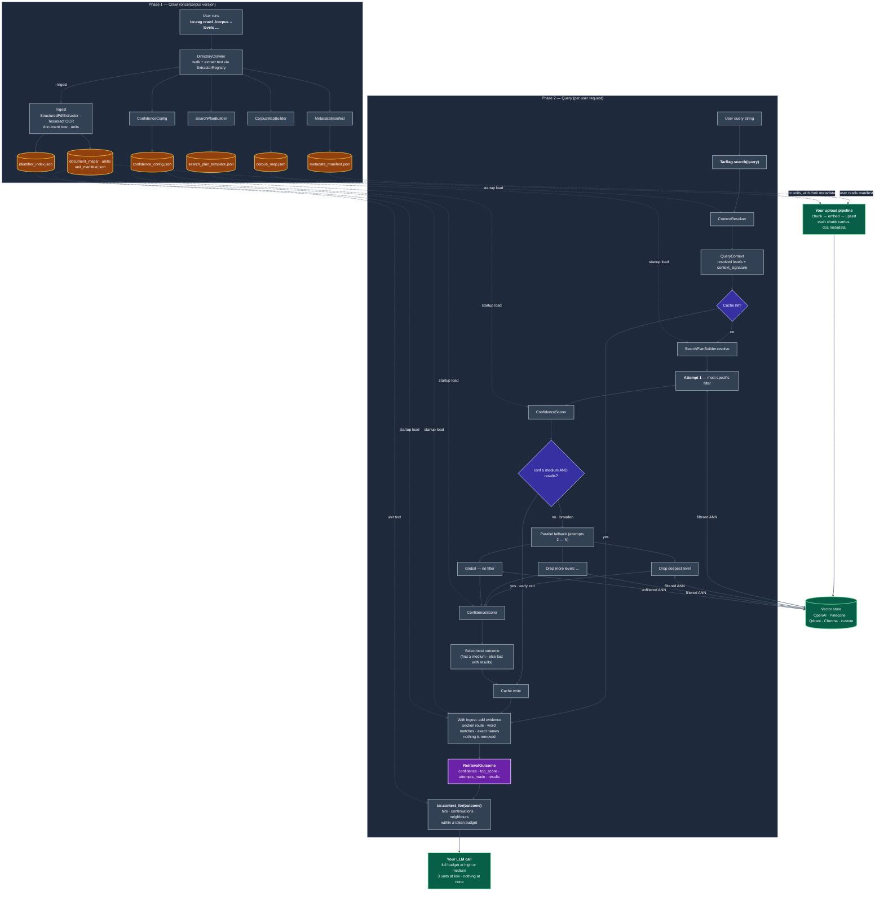

# tar-rag — How-to guide

This guide is for developers integrating `tar-rag` into a real pipeline.
For the high-level pitch, and the use-case list,
see [`README.md`](../README.md). For measured benchmark numbers, see
[`benchmarks/benchmark.md`](../benchmarks/benchmark.md).

---

## Table of contents

1. [Prerequisites](#prerequisites)
2. [Quickstart (three steps)](#quickstart-three-steps)
   - [Step 1 — Crawl your corpus](#step-1--crawl-your-corpus)
   - [Step 2 — Upload to your vector store](#step-2--upload-to-your-vector-store)
   - [Step 3 — Query through tar-rag](#step-3--query-through-tar-rag)
3. [File-level ingest](#file-level-ingest)
4. [Tuning for your corpus + embedding model](#tuning-for-your-corpus--embedding-model)
5. [Custom vector store adapter](#custom-vector-store-adapter)
6. [Custom extractors](#custom-extractors)
7. [Async usage](#async-usage)
8. [Clarification flow (multi-turn)](#clarification-flow-multi-turn)
9. [Security](#security)
10. [Architecture detail](#architecture-detail)

---

## Prerequisites

```bash
pip install tar-rag
```

The core install includes every file extractor and OCR, and no vector store
or LLM client. Add the client you use:

```bash
pip install "tar-rag[openai]"     # or pinecone, qdrant, chroma
pip install "tar-rag[all]"        # all four
```

Each adapter takes a client you create, so a store you do not use is never
imported.

---

## Quickstart (three steps)

### Step 1 — Crawl your corpus

```bash
# With explicit semantic level names — recommended:
tar-rag crawl ./corpus \
    --levels category,product,sub_type \
    --output ./tar_rag_output/

# Or let the crawler infer depth from your directory layout:
tar-rag crawl ./corpus --output ./tar_rag_output/
# warning: 'auto-inferred level_names = ["level_0", "level_1", "level_2"]'
```

**About level names.** Pass `--levels` whenever you can: the names you
choose appear in the manifest, in every chunk's metadata in the vector
store, and as keys in `tar-rag`'s filter dicts. Semantic names like
`category,product,sub_type` are far easier to debug than `level_0,
level_1, level_2`. If you omit `--levels`, the crawler scans the deepest
path under the corpus root, generates generic names, and warns you —
useful for a quick first look but worth replacing with semantic names for
anything you'll keep.

The crawl writes four JSON artifacts:

| Artifact | Used by |
|---|---|
| `corpus_map.json` | `ContextResolver` at query time |
| `metadata_manifest.json` | **Your** upload pipeline (Step 2) |
| `search_plan_template.json` | The orchestrator's fallback strategy (editable) |
| `confidence_config.json` | Confidence thresholds (tunable per embedding model) |

You can also drive the crawler from Python:

```python
from tar_rag import DirectoryCrawler, build_artifacts

crawler = DirectoryCrawler(
    root="./corpus",
    level_names=["category", "product", "sub_type"],  # or None to auto-infer
)
documents = crawler.crawl()
bundle = build_artifacts(documents, level_names=crawler.level_names)
bundle.write("./tar_rag_output/")
```

### Step 2 — Upload to your vector store

`tar-rag` does **not** own upload. Your existing pipeline keeps doing the
upload — `tar-rag` just tells you what metadata to stamp on each chunk
via `metadata_manifest.json`. Read the manifest, attach `doc.metadata` to
every chunk you upsert.

#### OpenAI Vector Stores

```python
from pathlib import Path

import openai
from tar_rag.manifest import MetadataManifest

client = openai.OpenAI()
manifest = MetadataManifest.load("./tar_rag_output/metadata_manifest.json")

vs = client.vector_stores.create(name=f"my-kb-{manifest.version}")
for doc in manifest:
    with open(Path("./corpus") / doc.relative_path, "rb") as f:
        uploaded = client.files.create(file=f, purpose="assistants")
    client.vector_stores.files.create(
        vector_store_id=vs.id,
        file_id=uploaded.id,
        attributes={k: v for k, v in doc.metadata.items() if v is not None},
    )
```

A complete, production-ready upload script lives next to this guide as
[`upload_openai.py`](upload_openai.py). Run it (from the repo root) with:

```bash
export OPENAI_API_KEY=<your key>
python examples/upload_openai.py \
    --manifest ./tar_rag_output/metadata_manifest.json \
    --corpus   ./corpus \
    --output   ./tar_rag_output/active_state.json
```

See [`integration_openai.md`](integration_openai.md) for the OpenAI
example and [`integration_other.md`](integration_other.md) for Pinecone,
Qdrant, and Chroma.

### Step 3 — Query through tar-rag

Identical user-facing API regardless of which vector store sits
underneath:

```python
from tar_rag import TarRag
from tar_rag.adapters import OpenAIVectorStoreAdapter  # or Pinecone / Qdrant / Chroma
import openai

tar = TarRag.from_artifacts("./tar_rag_output/")
tar.set_adapter(OpenAIVectorStoreAdapter(
    client=openai.OpenAI(),
    vector_store_id="vs-abc123",
    top_k=6,
))

result = tar.search("How does the OAuth token refresh flow work?")
print(result.confidence)      # "high" | "medium" | "low" | "none"
print(result.top_score)       # e.g. 0.87
print(result.attempts_made)   # how deep into the fallback chain we went
print(result.reason)          # "resolved_context" | "<level>_only" | "drop_<level>" | "global_fallback"
                              # with ingest, also "section_route" | "identifier_match"

for chunk in result.results:
    print(chunk.score, chunk.snippet[:200])
    print(chunk.metadata)     # carries the level values + doc_id + source_path
```

---

## File-level ingest

The quickstart treats each file as one thing and leaves chunking to you. For
long documents, let `tar-rag` go inside them.

### Build

```bash
tar-rag crawl ./corpus \
    --levels category,product,sub_type \
    --output ./tar_rag_output/ \
    --ingest
```

| Flag | Default | What it does |
|---|---|---|
| `--ingest` | off | Builds section maps, units and the identifier index, next to the four usual artifacts. |
| `--max-unit-tokens` | `800` | Token limit for one unit, estimated at 2.6 characters per token. A larger table or section splits, and a split table repeats its header. |
| `--workers` | up to `4` | Worker processes for reading PDFs. |

The output folder must be outside the corpus. A rerun replaces what an earlier
run wrote, and a folder that holds other files is refused. The new output is built
aside and swapped in at the end, so a run that stops early leaves the earlier output
whole. A file that fails is listed in the summary under `failed`, and the run
continues.

`tar-rag crawl` exits with `0` on success, `1` on an error and `2` on bad arguments.
With `--ingest` it exits with `3` when the run finished but content is missing: a
file failed, a page failed, or a page still needs OCR. It then prints a warning to
stderr, even with `--quiet`, and still writes the output. `failed_pages` is in the
summary, and each file's `document_maps/<doc_id>.json` lists the pages. Its
`unverified_pages` are pages the value check could not read. Their text is kept.

A plain crawl into the same folder does not refresh the ingest artifacts. If the
corpus changed, `from_artifacts` warns, ignores them and stays at folder level until
you run `--ingest` again. After a re-ingest, resync your store: a stored unit that
the manifest no longer lists still reaches the LLM with its stored text.

From Python, keep the call under a main guard, because PDFs are read in worker
processes:

```python
from tar_rag import DirectoryCrawler, StructuredPdfExtractor, build_artifacts, ingest_documents

if __name__ == "__main__":
    crawler = DirectoryCrawler(root="./corpus", level_names=["category", "product"])
    documents = crawler.crawl()
    bundle = build_artifacts(documents, level_names=crawler.level_names)
    bundle.write("./tar_rag_output/")

    summary = ingest_documents(
        documents,
        "./tar_rag_output/",
        level_names=crawler.level_names,
        corpus_version=bundle.manifest.version,
        pdf_extractor=StructuredPdfExtractor(max_workers=4),
    )
    print(summary.units, summary.ocr_pages, summary.needs_ocr_pages, summary.failed)
```

### What it writes

| Artifact | Used by |
|---|---|
| `document_maps/<doc_id>.json` | `SectionRouter` at query time. Also holds the extraction report for the file. |
| `units/<doc_id>/<n>.md` | **Your** upload pipeline, and the context step |
| `unit_manifest.json` | **Your** upload pipeline: one row per unit, with its path, title, tokens and metadata |
| `identifier_index.json` | Exact-name lookup at query time |

Each unit's metadata holds your folder levels plus:

| Key | Meaning |
|---|---|
| `doc_id`, `source_path` | The file it came from |
| `unit_id` | Links a search result back to the unit. **Required** for the context step to find neighbours. |
| `section_1` to `section_4` | Section keys by depth, used as filters. Absent below the depth a unit has. |
| `page_start`, `page_end` | Page range, 0 for formats with no pages |
| `unit_kind` | `text`, `table` or `mixed` |
| `unit_source` | Where the text came from: `ocr` marks OCR text |

### How each file gets its tree

| File | Tree |
|---|---|
| PDF with usable bookmarks | The bookmarks. They need at least 2 entries reaching at least half of the file, and must match the page text. |
| PDF with 3 or more detected headings | The headings, found from type size and numbering |
| Other PDF | Windows of 10 pages |
| Scanned PDF | Numbered headings in the OCR text, otherwise windows of 10 pages |
| Markdown, HTML, DOCX | Their own headings |
| Anything else | No sections: units in reading order |

Inside a section, units split again on headings below the tree, such as numbered
sub-headings that the bookmarks leave out.

### Upload

Upload units, not raw files, and store each with its `metadata`.
[`upload_units_openai.py`](upload_units_openai.py) does this for OpenAI, and prints
the store id:

```bash
export OPENAI_API_KEY=<your key>
python examples/upload_units_openai.py --output-dir ./tar_rag_output --name my-kb
```

It stores each unit as one file, because OpenAI attributes apply per file and section
filters need them. That is slower than uploading whole files. For any other store,
read each row, embed its text with your own model, and store it with `row["metadata"]`:

```python
import json
from pathlib import Path

base = Path("./tar_rag_output")
manifest = json.loads((base / "unit_manifest.json").read_text(encoding="utf-8"))
for row in manifest["units"]:
    text = (base / row["path"]).read_text(encoding="utf-8")
    your_store.upsert(id=row["unit_id"], text=text, metadata=row["metadata"])
```

Unit paths come from the manifest, so read the manifest only from an output folder
you made.

### Query

`TarRag.from_artifacts` finds the ingest artifacts by itself. With them it fetches
12 results for each attempt, not 6. `search()` runs the normal folder search, then
adds evidence, and takes nothing away:

| Evidence | When it runs | Effect |
|---|---|---|
| Section route | Query words cover at least half the weight of a section title, and one section wins clearly | Adds a search filtered to that section. `reason` becomes `section_route`. |
| Word matches | Every query | A BM25 index over the units adds up to 3 units, or all of a short document. When the store finds nothing, they fill the results up to `top_k` instead. Their score is 0, so they cannot raise confidence. |
| Exact names | The query holds a name from the identifier index | Puts those units first. `reason` becomes `identifier_match`. Confidence becomes `high` when at most 6 units hold the query's spelling. Otherwise it stays as the search set it, at `low` or above. |

Lookup compares names with look-alike characters folded (`I` and `L` to `1`, `O` to
`0`), so an OCR misread can still match. Units with the query's own spelling rank
first, so `REG_10` comes before a look-alike `REG_IO`.

Pinned `explicit_levels` limit all three: a file with no value at a pinned level is
left out, and case does not matter. A query names a folder when its words spell the folder name,
with spaces, hyphens and `+` ("plus") set aside: "Cyclone IV" names `CycloneIV`, and "Zynq
UltraScale+" names `ZynqUltraScalePlus`. Whole words only, so "PSoC 62" does not name `PSoC6`. A
name that is not a spelling of the folder, such as one part number in a folder named for its series,
needs a document alias. Word matches also prefer the scope a query names.
They widen when no telling word of the query matches there: words that name the scope,
or that appear in more than a tenth of all units, do not count. Pins are a search
filter, not access control: the folder search can still widen past a pin when its
fallback chain reaches a global attempt.

Then build the context:

```python
query = "What does the IRQ_ENABLE field do?"
result = tar.search(query)
bundle = tar.context_for(result, max_tokens=3460)

prompt = f"Answer from this context only.\n\n{bundle.text}\n\nQuestion: {query}"
if bundle.has_ocr:
    prompt += "\n\nSome text came from OCR. Allow for misread characters, such as 12C for I2C."
```

`context_for` fills the budget in this order: the first 5 hits, each with the rest
of its section if it was split on size; the units beside those hits in the same
chapter; then the remaining hits and their neighbours. Text identical to text
already taken is dropped. The result is grouped by document, in reading order.

| Confidence | What `context_for` returns |
|---|---|
| `high`, `medium` | Up to the full budget |
| `low` | The first 3 hits, so your LLM can answer or decline |
| `none`, or no results | Nothing |
| Any, with no vector store (`word_only`) | Up to the full budget when there are results; nothing when there are none |

Check `bundle.skipped` to see how many units the budget left out. Set `max_tokens`
for your own model. The default was chosen for one test set, so it is a starting
point.

### No vector store

After `--ingest`, the units are enough to search on their own. Load the artifacts without an adapter:

```python
tar = TarRag.from_artifacts("./tar_rag_output/")   # no adapter
result = tar.search("What does the IRQ_ENABLE field do?")
bundle = tar.context_for(result)
```

`search()` runs the folder and section routing, the exact-name lookup and the word search, and skips
the vector search. Each outcome has `word_only=True`. Word results carry no similarity score, so
`confidence` stays `none` unless an exact name raises it, and `context_for` fills the budget whenever
there are results (see the table above). A query with no results still gets nothing.

- Without `--ingest` there are no units to search, so `search()` without an adapter still raises
  `AdapterConfigurationError`.
- `tar.set_adapter(...)` switches to the normal mode. A cache given with `set_cache()` in word-only
  mode is held and attached then, so results found without a store are never served from the cache
  once a store is set.

### Scanned pages and OCR

OCR is always part of ingest. Tesseract reads pages with graphics and no text layer,
pages that are mostly one image with little text, and pages whose text layer is
garbled. Blank pages are skipped, and a page that fails is listed in
`report.needs_ocr_pages` while the run continues.

```python
from tar_rag import StructuredPdfExtractor, TesseractOcr

StructuredPdfExtractor(ocr=TesseractOcr(lang="deu", tessdata_dir="/path/to/tessdata"))
StructuredPdfExtractor(ocr=my_engine)   # any callable(png_bytes, page_number) -> text
```

Only the English model ships with `tar-rag`. For another language, download its
`.traineddata` file and pass the folder as `tessdata_dir`.

### Known limits

- A table on a scanned page becomes lines of text, and blank cells can shift.
- OCR text can hold misread characters, and has no confidence score.
- A table drawn without ruling lines stays as text.
- A horizontal watermark across the page body is not removed.
- The first query in a process also builds the word index in memory. That query took
  3 to 8 seconds in total at about 5,000 units in our test. Run one query at startup
  in a service.
- The context budget and the unit limit are estimates from characters, not from your
  model's tokenizer.

---

## Tuning for your corpus + embedding model

The values that ship with `tar-rag` are **default tuning values** —
sensible starting points calibrated against OpenAI's
`text-embedding-3-large`, not optimal values for any particular corpus.
Different embedding models produce different score distributions, and
different corpora put different floors on what "weakly related" looks
like — so you'll want to tune the thresholds once after seeing a few real
queries from your own data.

All tunable parameters live in **plain JSON or function arguments**. No
code changes required.

### Confidence thresholds — `tar_rag_output/confidence_config.json`

This is the file you'll most likely edit. It controls when retrieval
results are classified as `high` / `medium` / `low` / `none`, which in
turn controls **whether `tar-rag` forwards the chunks to your LLM or
gates them out**.

| Parameter | Default | What it does | When to **raise** | When to **lower** |
|---|---|---|---|---|
| `high_single` | `0.78` | Top result's score ≥ this → tier = **high** by itself. | If your model regularly scores irrelevant chunks at 0.78+ (overconfident defaults). | If your model clusters good chunks at 0.6-0.7 (sentence-transformers families often do). |
| `high_combo` | `0.68` | Top ≥ this **AND** second ≥ `high_combo_second` → also **high**. Catches "consistent moderate" cases the single-rule misses. | To require stronger agreement before promoting to high. | If your model rarely produces two-result consensus even when answers are obvious. |
| `high_combo_second` | `0.55` | The 2nd-place score threshold paired with `high_combo`. | Together with `high_combo` if you want stricter consensus. | If 2nd-place scores typically fall off a cliff in your store. |
| `medium_min` | `0.58` | Top score ≥ this → **medium**. **Below this → low / none → `tar-rag` forwards 0 chunks to your LLM.** This is the token-saving gate. | To be stricter about what reaches your LLM (fewer false positives, slightly higher gating). | To be more permissive (fewer over-gated true-positives). |

Rules in priority order: `high_single` → `high_combo` → `medium_min` →
otherwise low / none.

**How to know what to set them to** — run 5–10 representative queries of
each category through `tar.search(...)` and look at `result.top_score`:

```python
for query in your_canonical_queries:
    r = tar.search(query)
    print(f"{query[:40]:40} {r.confidence:6} top={r.top_score:.2f}")
```

You'll see the score distribution split naturally. Set `medium_min`
between the lowest "should-pass" query's top score and the highest
"should-be-gated" query's top score. The other thresholds usually fall
into place once `medium_min` is right.

A concrete worked example with numbers — including a real false positive
caught by tuning `medium_min` from `0.58` to `0.72` — lives in
[`benchmarks/benchmark.md`](../benchmarks/benchmark.md).

### Retrieval behaviour — adapter and orchestrator arguments

| Parameter | Where | Default | What it does | When to tune |
|---|---|---|---|---|
| `top_k` | `TarRag.from_artifacts(..., top_k=...)` | `12` with ingest artifacts, else `6` | How many chunks each search attempt returns. Applied per attempt — so for a 4-attempt fallback chain, the orchestrator may evaluate up to `4 * top_k` chunks before settling on the best outcome. | Raise if your downstream LLM has a large context window and you want more recall. Lower if you want faster, cheaper queries (most vector stores scale latency with `top_k`). |
| `parallel_fallback` | `TarRag.from_artifacts(..., parallel_fallback=...)` | `True` | Whether attempts 2…N run in parallel after attempt 1 fails. | Set `False` for sequential fallback when debugging (easier to read logs) or when your adapter doesn't tolerate concurrent calls. |
| `cache_root` | `TarRag.from_artifacts(..., cache_root=...)` | `None` (in-memory only) | Directory on disk for the retrieval cache. With a path set, cache survives process restarts. Keyed by `(query, corpus_version, context_signature)` — re-crawling automatically invalidates. | Set to a project-local path in production; leave unset for one-off scripts. |
| `max_tokens` | `tar.context_for(outcome, max_tokens=...)` | `3460` | Context budget. | Lower to save tokens, raise if list answers come back incomplete. |

### Search plan — `tar_rag_output/search_plan_template.json`

The orchestrator reads this file (if present) for the fallback chain. You
can edit it directly to:

- **Disable specific fallback levels** (e.g. remove the global attempt if
  you'd rather return "no answer" than risk an off-topic result).
- **Reorder attempts** if some level combinations are more meaningful to
  try first for your corpus.
- **Toggle `allow_broaden`** on any attempt to make it terminal — the
  orchestrator stops broadening past an attempt with
  `allow_broaden: false`.

If the file is absent at query time, `tar-rag` regenerates the chain
dynamically from `level_names` — so deleting the file effectively "resets
to defaults."

### When to NOT tune

If your benchmark numbers look reasonable on the defaults, don't tune.
The defaults aim to be the right starting point for most users on
`text-embedding-3-large`; over-tuning to a small query set risks
hand-fitting and won't generalise.

---

## Custom vector store adapter

`tar-rag` produces filter dicts in one of three shapes:

```python
None                                                           # global / unfiltered
{"type": "eq", "key": "product", "value": "acme"}          # single level
{"type": "and", "filters": [                                   # multi-level
    {"type": "eq", "key": "category", "value": "instruments"},
    {"type": "eq", "key": "product", "value": "acme"},
]}
```

An adapter is one class with one method that translates this dict to your
store's native filter format and returns `SearchResult` instances:

```python
from tar_rag.adapters import AbstractVectorStoreAdapter
from tar_rag.models import SearchResult

class MyStoreAdapter(AbstractVectorStoreAdapter):
    def search(self, query, filters, top_k):
        native_filter = self._translate(filters)
        rows = self._client.query(query=query, filter=native_filter, top_k=top_k)
        return [
            SearchResult(
                score=row.score,
                snippet=row.text[:1500],
                metadata=row.metadata,
                doc_id=row.metadata.get("doc_id"),
                filename=row.metadata.get("filename"),
            )
            for row in rows
        ]

    def _translate(self, filters):
        if filters is None:
            return None
        if filters["type"] == "eq":
            return my_store_eq(filters["key"], filters["value"])
        if filters["type"] == "and":
            return my_store_and([self._translate(f) for f in filters["filters"]])
```

The async path is taken care of for you — `asearch` defaults to running
`search` in a thread. Override it only if your client has a native async
API and you want true async I/O.

---

## Custom extractors

Each file type is handled by a `TextExtractor` subclass registered to one
or more extensions. These extractors serve the plain crawl. `--ingest` reads PDF,
Markdown, HTML and DOCX itself, to keep their structure. To swap in `pdfplumber`
for PDFs in a plain crawl, or add a brand-new format:

```python
from tar_rag import DirectoryCrawler
from tar_rag.extractors.base import TextExtractor

class PdfPlumberExtractor(TextExtractor):
    def extract(self, path):
        import pdfplumber
        with pdfplumber.open(path) as pdf:
            return "\n".join((page.extract_text() or "") for page in pdf.pages)

crawler = DirectoryCrawler(root="./corpus", level_names=["category", "product"])
crawler.extractors.register(".pdf", PdfPlumberExtractor())
documents = crawler.crawl()
```

The registry is mutable — call `register()` to add or replace an
extension, `deregister()` to remove one, `supported_extensions()` to list
them.

---

## Async usage

Every public entry point has a sync and async form, with the same
arguments and the same return type:

| Sync | Async |
|---|---|
| `tar.search(query)` | `tar.asearch(query)` |
| `orchestrator.execute(ctx, attempts)` | `orchestrator.aexecute(ctx, attempts)` |
| `adapter.search(query, filters, top_k)` | `adapter.asearch(query, filters, top_k)` |
| `cache.get(key)` / `cache.set(key, value)` | `cache.aget(key)` / `cache.aset(key, value)` |

```python
result = await tar.asearch("How does the OAuth token refresh flow work?")
```

**Under the hood:**

- For each fallback attempt, the orchestrator calls `adapter.asearch(...)`.
- The default `asearch` on `AbstractVectorStoreAdapter` runs the sync
  `search()` in a worker thread via `asyncio.to_thread`. Every adapter is
  async-compatible out of the box even if its underlying client is
  sync-only.
- Adapters whose client has a native async API (e.g.
  `openai.AsyncOpenAI`, `AsyncQdrantClient`) can override `asearch` for
  true async I/O. The bundled `OpenAIVectorStoreAdapter` and
  `QdrantAdapter` accept an optional `async_client` argument and use it
  if provided.
- Parallel fallback uses `asyncio.gather` on the async path and
  `concurrent.futures.ThreadPoolExecutor` on the sync path — the fallback
  shape and ordering are identical.

`asearch` and `search` produce equivalent `RetrievalOutcome` results
given equivalent inputs (modulo wall-time differences from the underlying
I/O). The orchestrator's decision logic — confidence gating, early exit,
progressive broadening, cache lookup — is the same.

---

## Clarification flow (multi-turn)

When the resolver can't pin down which branch the user means, `result`
carries a clarification prompt you can show to your user:

```python
if result.needs_clarification:
    print(result.clarification["prompt"])
    for option in result.clarification["options"]:
        print(option["id"], option["label"])
```

To resume after the user picks an option, pass the prior turn back as
conversation history:

```python
from tar_rag import ConversationTurn

conversation = [
    ConversationTurn(role="user", content="original question"),
    ConversationTurn(
        role="assistant",
        content=result.clarification["prompt"],
        type="clarification",
        metadata={
            "options": result.clarification["options"],
            "original_query": result.clarification["original_query"],
        },
    ),
]
follow_up = tar.search(user_reply, conversation=conversation)
```

---

## Security

- **Documents are untrusted input.** Text from your corpus reaches your LLM, and a
  document can hold instructions written to steer it (prompt injection). `tar-rag`
  does not detect or remove these. Keep retrieved text apart from your system prompt,
  mark it as data, and do not let it trigger tools or actions by itself.
- **No network, no keys.** `tar-rag` makes no network calls of its own and reads no
  API key. Your adapter talks to your store with the client you gave it.
- **The output folder holds your corpus text in clear.** So does a disk cache set with
  `cache_root`. Protect both as you protect the corpus, and do not publish them.
- **Parsing runs native code.** PDF and OCR libraries process each file. For files from
  people you do not trust, run ingest in a sandbox with limits on time and memory.

---

## Architecture detail

The full data flow end-to-end, including the crawl phase, the artifact
files, the file-level ingest stage, and the parallel fallback chain.

**Solid arrows** are the runtime execution path. **Dashed arrows** are
artifact files read into memory once at startup (or, in the case of the
manifest, read by your upload pipeline). **Diamonds** are decision
points.


